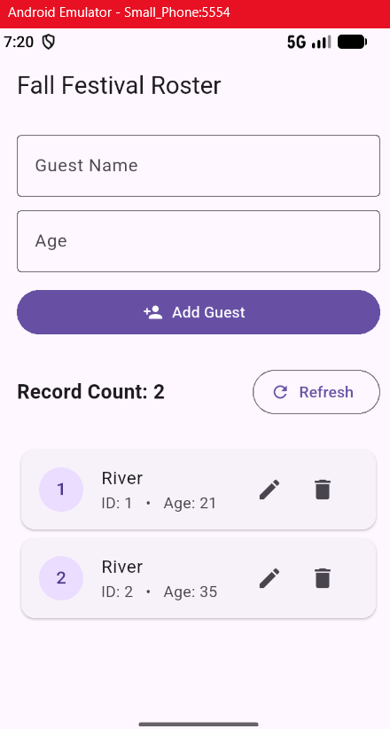
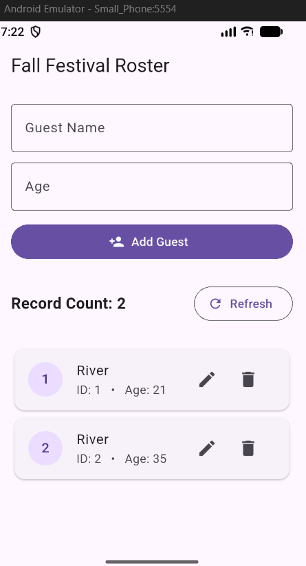
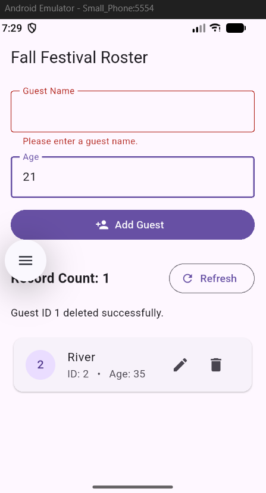
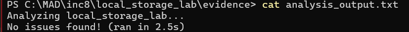

# In-Class 08 / Fall Festival Roster

**Student / course/section / pathway:** Janiya Green / [Course and Section] / [Undergraduate]

**Flutter / Dart versions; device / OS:** Flutter 3.47.4 / Dart SDK 3.13.3 / ASUS Vivobook Windows 11

## Setup/run commands

Run these commands from the Flutter project root.
```bash
flutter --version
dart --version
flutter pub get
flutter devices
flutter run
````

Packages: `sqflite`, `path`, `path_provider`, and Flutter SDK.

Source files:

- lib/main.dart — app startup, roster UI, input validation, and CRUD operations.
- lib/database_helper.dart — SQLite initialization, schema, and database CRUD methods.

## Storage notes

- **Schema and initialization:** `DatabaseHelper.init()` in `lib/database_helper.dart` opens `MyDatabase.db` in the application documents directory. It creates `my_table` with `_id` as an auto-incrementing integer primary key, `name` as required text, and `age` as a required integer. In `lib/main.dart`, `main()` initializes the database before starting the app, and `_loadGuests()` retrieves saved records for display.

- **Input policy, IDs, CRUD source locations:** Guest names cannot be blank, and ages must be whole numbers from 0 to 130. SQLite generates unique integer IDs, and updates and deletions use the ID to identify the correct record. Insert: `DatabaseHelper.insert()` and `_saveGuest()` in `lib/main.dart`. Read: `queryAllRows()`, `queryRowCount()`, and `_loadGuests()`. Update: `DatabaseHelper.update()` and `_saveGuest()`. Delete: `DatabaseHelper.delete()` and `_deleteGuest()`. Edit and cancel: `_editGuest()` and `_cancelEdit()`.

- **Memory example / preference example / SQLite example:**
  - **Memory state:** `_count = 2` represents the current roster count in the app's state. This value is held in memory and refreshed from SQLite.
  - **Key-value preferences:** A hypothetical example is `theme = "dark"` stored using `shared_preferences`. This app does not currently use key-value preferences.
  - **SQLite record:** River's saved record is `{_id: 1, name: "River", age: 21}`. The second River record is `{_id: 2, name: "River", age: 35}` after the T3 update.

## Actual Tests

| Test ID | Action/input | Expected | Observed IDs/ages/count | Pass/fail |
| ------- | ------------ | -------- | ----------------------- | --------- |
| T1 / Empty | Refresh the lab roster after confirming it has no rows. | Count 0, successful empty-state message. | Empty Roster | Pass |
| T2 / Create | Add both River records. | Count 2; distinct generated IDs A and B. | River A = ID: 1, age: 21; River B = ID: 2, age 34; Record Count = 2 | Pass |
| T3 / Identity | Edit B to 99, then Cancel; verify no change. Edit B again and Save age 35. | Cancel stops River ID 2 from updating, until saved is clicked and updates age to 35 | River A = ID: 1, age: 21; River B = ID: 2, age 35; Record Count = 2  | Pass |
| T4 / Restart | Stop the app process and relaunch the same installation without clearing data. | Same IDs, names, ages, and count; no reseeding. | Before: ; after: ; Record count: 2 | Pass |
| T5 / Delete | Cancel deletion of A, then confirm it; Refresh. | Cancel leaves count 2; confirm returns 1; after Refresh only B remains, count 1. A second restart is not required. | Only River B remains, record count updates to 1 | Pass |
| T6 / Validation and boundaries | In Add mode, try a space-only name with age 21. Next use name “Maple” while trying ages “abc”, 1.5, -1, 131 separately. Finally add “Acorn” with age 0 and “Oak” with age 130. | Each invalid attempt shows feedback and leaves count 1/B unchanged. Acorn and Oak are accepted with distinct IDs; final count 3. These use five rejected attempts and two accepted inserts. | <ol>Invalid Attempts<li>[Space only name], Age 21</li><li>Maple, Age abc</li><li>Maple, Age 1.5</li><li>Maple, Age '-1'</li><li>Maple, Age 131</li></ol><ol>Boundary Results<li>Acorn, Age 0, ID: 3</li><li>Oak, Age 0, ID: 4</li></ol> | Pass |

T4 stop/relaunch method:

Device and OS: sdk gphone16k x86 64 (mobile) • emulator-5554 • android-x64    • Android 17 (API 37) (emulator)
Exact method used:
- Save `evidence/T4_before.png`. Stop the Flutter debug session. Open the lab app's system App info and select Force stop. Reopen the app from its launcher icon. Do not clear storage or uninstall. Save `evidence/T4_after.png`.


Evidence:
-  — both River records, IDs, ages, and count before restart.
-  — roster after the qualifying stop/relaunch.
-  — one rejected T6 input with visible validation feedback.
- `evidence/analysis_output.txt` — actual output from `flutter analyze`.

## Analyzer command/result:

Actual analyzer result: 

## Short reflections

### 1. The disappearing-data mystery (all students):
Before T4, predict what will survive and why. Include your actual IDs, values, count, stop/relaunch method, and before/after evidence references. Trace the path from init() through the first query to the visible list in your own implementation. What observation would disprove your claim that SQLite restored the data?

### 2. Two Rivers, one wrong edit (all students):
Use your T2-T3 IDs, ages, and affected-row result to explain why a name is not a reliable identifier. Point to the update call in your own source. Give one short hypothetical example of how selecting by list position after a sort could target the wrong record. No additional experiment is required.

### 3. Your own usability walkthrough (all students):
Perform Add/Edit/Cancel/Delete yourself during T2-T5. Record one specific observation from your screen, then propose one small improvement and its trade-off; implementation is not required. Refer to your T6 feedback and count to explain how you know invalid input did not save. If you found a real bug, briefly note the fix or remaining limitation; a bug is not required.